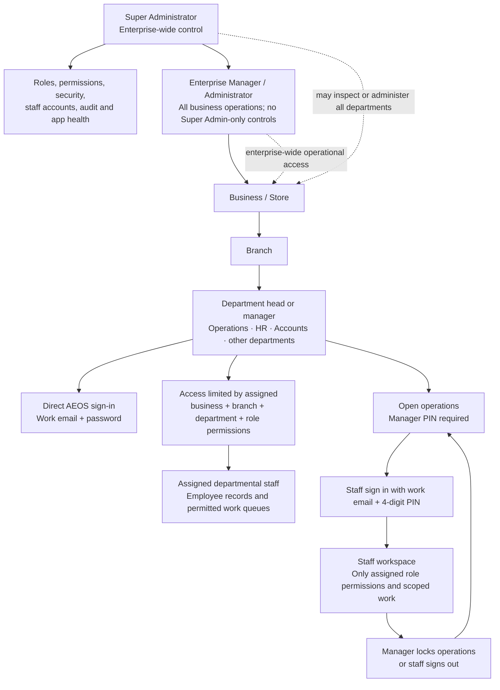
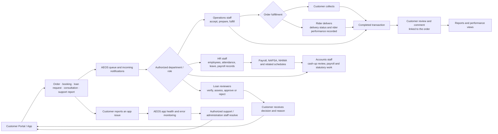
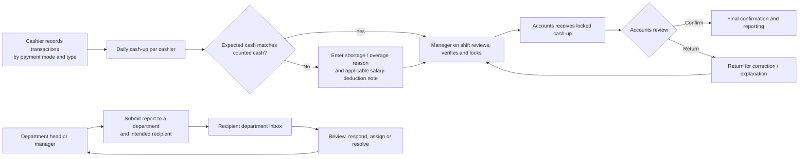
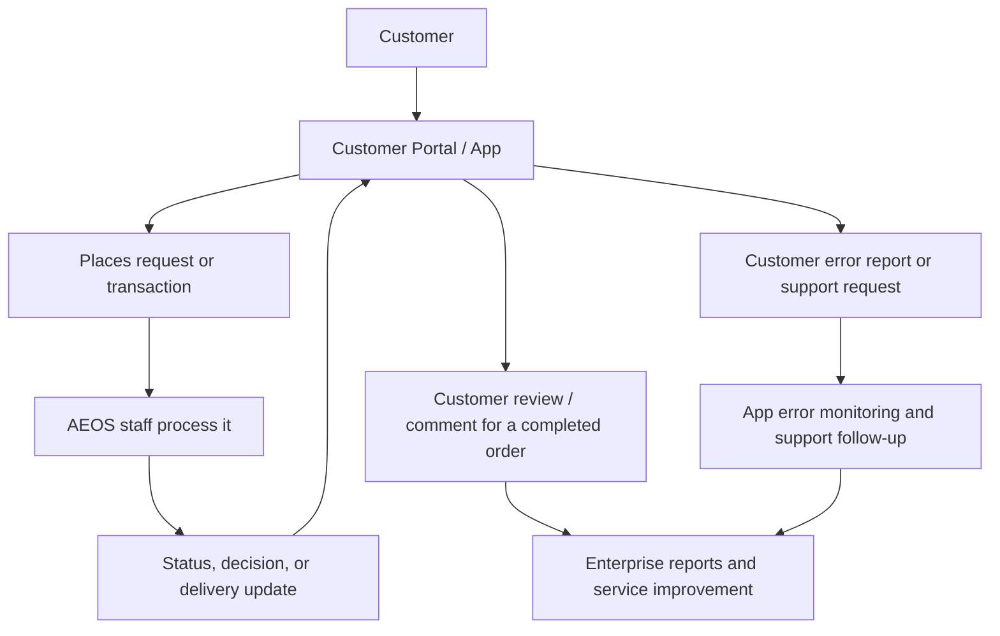

# AEOS Management and Customer Map

This map shows how governance, department access, staff operations, and customer activity fit together in Alessandro Enterprises Operating System (AEOS).

## Company management tree

The company tree separates **who reports to whom** from **which AEOS pages each role can use**. Roles and departments can be assigned to each account in Staff Accounts; the business, branch, and department assignment scopes staff visibility.

```text
Alessandro Enterprises
├── Enterprise governance
    ├── Super Administrator
    │   ├── Owns enterprise-wide administration and security
    │   ├── Creates and manages staff accounts, roles, and permissions
    │   ├── Oversees businesses, branches, audit activity, and app health
    │   └── Retains Super Admin-only controls
    │
    └── Enterprise Manager / Administrator
        ├── Runs enterprise operations across businesses
        ├── Coordinates business and branch managers
        └── Cannot grant or use Super Admin-only controls

            ├── Shared enterprise departments
            │   ├── Human Resources (HR)
            │   │   ├── HR Head / HR Manager
            │   │   ├── HR officers and assigned HR staff
            │   │   ├── Employee records and department assignments
            │   │   ├── Leave, attendance, employee documents
            │   │   ├── Employee loans and advances
            │   │   ├── Payroll coordination and HR reports
            │   │   └── Rider/employee records
            │   │
            │   ├── Accounts and Finance
            │   │   ├── Accounts Head / Finance Manager
            │   │   ├── Accounts officers and assigned finance staff
            │   │   ├── Cash-up final review and confirmation
            │   │   ├── Cash shortages and salary recovery
            │   │   ├── Payroll liabilities and statutory schedules
            │   │   │   (NAPSA, NHIMA, and configured statutory items)
            │   │   ├── General ledger and journals
            │   │   └── Financial statements and reports
            │   │
            │   ├── Operations
            │   │   ├── Operations Head / Operations Manager
            │   │   ├── Branch or shift managers
            │   │   ├── Order, booking, product, and service teams
            │   │   ├── Cashiers and payment-mode handling
            │   │   └── Dispatch and delivery coordination
            │   │
            │   ├── Customer Service and Communications
            │   │   ├── Customer service lead
            │   │   ├── Customer support staff
            │   │   ├── Customer requests, messages, and email
            │   │   ├── Customer app issue follow-up
            │   │   └── Reviews and service feedback
            │   │
            │   └── Other configured departments
            │       └── Each has a department head, assigned staff,
            │           role permissions, and report inbox
            │
            └── Business / Store managers
                └── Assigned business and branch
                    ├── Alessandro Elite Fashion
                    │   ├── Fashion / retail manager
                    │   ├── Sales and customer service staff
                    │   ├── Product, stock, and catalogue staff
                    │   └── Tailoring / order fulfilment staff
                    │
                    ├── Alessandro Classic Barbershop
                    │   ├── Barbershop manager
                    │   ├── Booking and walk-in desk
                    │   ├── Barbers and service staff
                    │   └── Queue and schedule coordination
                    │
                    ├── Alessandro Mobile Money
                    │   ├── Mobile money manager
                    │   ├── Cash-in / cash-out operators
                    │   ├── Transfer and bill-payment operators
                    │   └── Float and commission reconciliation
                    │
                    ├── Alessandro Soft Loans
                    │   ├── Loans manager
                    │   ├── Loan application and document officers
                    │   ├── Assessment and approval officers
                    │   └── Repayment and customer follow-up staff
                    │
                    ├── Alessandro Tech Solutions
                    │   ├── Tech Solutions manager
                    │   ├── Consultation and customer support staff
                    │   ├── Repair / job-card coordinators
                    │   └── Assigned technicians
                    │       (networking, software, web, CCTV, warranty)
                    │
                    └── Alessandro Delivery Service / shared dispatch
                        ├── Delivery or dispatch manager
                        ├── Dispatch coordinators
                        ├── Riders
                        └── Delivery tracking and performance reporting

└── Customers (separate from the staff reporting tree)
    └── Customer Portal / App
        ├── Customer account and profile
        ├── Orders, bookings, and loan requests
        ├── Consultation and support requests
        ├── Delivery status updates
        ├── Reviews and comments on orders
        └── App issue reports
```

### Reporting and access in practice

1. A Super Administrator creates the manager or department-head account, assigns its role and permissions, and selects its business, branch, and department.
2. A business/branch manager coordinates that location. A department head directs the staff assigned to that department and location; central HR and Accounts teams provide shared services across the businesses according to their assigned scope and permissions.
3. Department heads and managers sign in to AEOS with their own email and password. A role with `operations.open` can open an operations session using its manager PIN.
4. Regular staff do not sign in directly to AEOS. They use their work email and four-digit PIN after the manager opens operations. Their active role controls their visible modules and allowed actions.
5. Customers sign in only to the separate Customer Portal. Staff accounts are blocked from the customer sign-in, and customer accounts are blocked from AEOS.

The actual employees and department names are configurable. This tree describes the intended company reporting structure; it does not assume that every listed title or team already has an assigned employee account.

## 1. Company structure and access



### Access rules

| Account | Sign-in | What it can access |
|---|---|---|
| Super Administrator | AEOS email and password | All businesses, branches, departments, and administration controls. Super Admin-only controls stay restricted to this role. |
| Enterprise Manager / Administrator | AEOS email and password | Enterprise operational areas and staff administration, except Super Admin-only controls. |
| Department head or manager | Own AEOS email and password; manager PIN to open operations | Role-permitted modules and staff for the assigned business, branch, and department. |
| Department staff | Work email and four-digit PIN after a manager opens operations | Role-permitted work within the active manager session and assigned work scope. Staff do not sign in directly to AEOS. |
| Customer | Customer Portal credentials | Customer-facing services and their own profile, requests, orders, bookings, loans, support, and reviews. Customers cannot enter AEOS. |

The role controls **which actions** are allowed. Business, branch, and department assignments control **which staff records and operational data** are in scope. Department heads must be assigned a department; staff are assigned to a matching department manager. Staff and customer accounts use separate sign-in paths.

## 2. How work moves through the enterprise



## 3. Cash handling and departmental reports



## 4. Customer-to-company feedback loop



## Where these controls live in AEOS

- **Staff Accounts / Roles & Permissions:** `/dashboard/administration/access`
- **Manager, staff, and administration workspaces:** `/dashboard/manager`, `/dashboard/staff`, and `/dashboard/administration`
- **Department work:** grouped in the AEOS sidebar and shown according to role permissions
- **Operations session:** manager opens and locks operations; staff PIN sessions are subordinate to that manager session
- **Cash reconciliation:** `/dashboard/reports/cash-reconciliation`, with final Accounts review under `/dashboard/reports/cash-reconciliation/account-review`
- **Accounts:** `/dashboard/accounts`
- **Customer orders and reviews:** `/dashboard/orders` and its customer review workflow
- **Customer Portal:** separate `/customer` experience; AEOS staff accounts are blocked from customer sign-in

**Database note:** department-level staff filtering depends on migration `051_department_head_scope_and_logins.sql`, in addition to the earlier staff-session and business/branch migrations.
